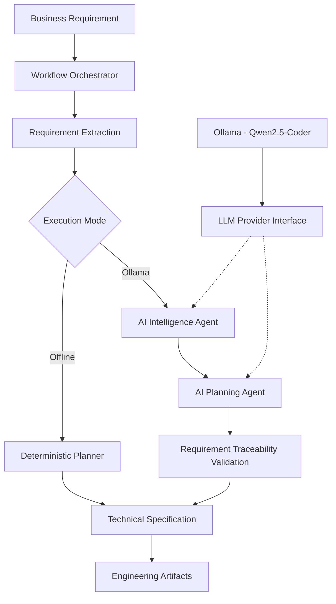

# Agentic SDLC Framework

An open-source reference implementation for intelligent,
traceable and governed AI-driven software engineering.


## Vision

Move beyond AI-assisted coding towards intelligent,
controlled and measurable software delivery.

The framework aims to progressively transform business
requirements into technical designs, implementation plans,
source code, tests and validation evidence.

## Current Milestone — v0.1.0

Part 1: From Business Intent to AI-Powered Technical Planning.

### Implemented Capabilities

- Workflow orchestration and state management
- Unique execution identifiers and execution history
- Structured business requirement extraction
- Requirement-level traceability
- Deterministic offline planning
- Provider-independent LLM interface
- Local Ollama integration
- AI Intelligence Agent
- AI Planning Agent
- AI response structure validation
- Missing, duplicate and unknown requirement ID detection
- Technical specification generation
- Structured artifact persistence
- LLM token usage and execution time tracking

## Architecture



## Framework Layers

| Layer | Responsibility | Status |
|---|---|---|
| Intelligence | Requirement and context analysis | Implemented |
| Planning | Technical planning and validation strategy | Implemented |
| Execution | Code and test generation | Planned |
| Assurance | Testing, review and remediation | Planned |
| Governance | Human approval and auditability | Foundational support |

Additional planned capabilities:

- Engineering Memory
- Engineering Quality Scorecard
- Additional LLM providers
- Continuous feedback and improvement
- GitHub Actions integration

## Technology Stack

- Python
- Ollama
- Qwen2.5-Coder 3B
- Pytest
- Ruff
- JSON and Markdown
- Git and GitHub

## Installation

Clone the repository:

```bash
git clone https://github.com/amising6/agentic-sdlc-framework.git
cd agentic-sdlc-framework
```

Create a Python virtual environment:

```bash
python3 -m venv .venv
source .venv/bin/activate
pip install -r requirements.txt
```

The current implementation was tested with Python 3.14.4.

## Running the Framework

### Offline Mode

No LLM installation or API key is required.

```bash
python main.py \
  --requirement examples/inventory.md \
  --provider offline
```

### AI Mode

Install Ollama using the official instructions:

https://ollama.com/download

Download the coding model:

```bash
ollama pull qwen2.5-coder:3b
```

Ensure the Ollama service is running.

```bash
curl http://localhost:11434/api/tags
```

Execute the AI-enabled workflow:

```bash
python main.py \
  --requirement examples/inventory.md \
  --provider ollama \
  --model qwen2.5-coder:3b
```

## Example Business Requirement

The initial demonstration uses a synthetic inventory
management module with six acceptance criteria:

1. Add new products to inventory.
2. Update available product quantities.
3. Prevent negative inventory quantities.
4. Identify products below the reorder threshold.
5. Generate an inventory summary.
6. Provide unit tests for all business rules.

Each requirement is assigned a unique identifier,
which is preserved throughout implementation planning.

## Generated Artifacts

A successful AI-enabled workflow produces:

```text
artifacts/
└── <run_id>/
    ├── requirement.md
    ├── analysis.json
    ├── ai_analysis.json
    ├── plan.json
    ├── spec.md
    ├── llm_usage.json
    └── execution.json
```

Offline mode does not generate AI-specific artifacts.

## Validation and Testing

Run automated tests:

```bash
python -m pytest tests/ -v
```

Run static code quality checks:

```bash
ruff check .
```

### Verified Implementation Results

| Metric | Result |
|---|---|
| Automated unit tests | 15 passed |
| Ruff checks | Passed |
| Synthetic acceptance criteria | 6 |
| Live AI Intelligence execution | 10.763 seconds |
| Intelligence input tokens | 307 |
| Intelligence output tokens | 130 |
| External LLM API charges | $0 |

The AI Intelligence metrics are from one local execution
on the development machine, not a performance benchmark.

The AI Planning Agent has passed its mocked unit tests.
Live end-to-end AI planning validation remains pending.

## Engineering Principles

- Business requirements remain the source of truth.
- AI recommendations are advisory.
- Requirement identifiers must remain traceable.
- AI-generated outputs require deterministic validation.
- Execution evidence should be auditable.
- Human oversight is essential.

The current traceability validator checks requirement ID
coverage. It does not establish semantic correctness.

## Implementation Roadmap

- [x] Core orchestration
- [x] Requirement extraction
- [x] Artifact persistence
- [x] Local LLM integration
- [x] AI Intelligence Agent
- [x] AI Planning Agent implementation and unit tests
- [ ] Live end-to-end AI planning validation
- [ ] AI Development Agent
- [ ] Independent Test Generation Agent
- [ ] Controlled execution environment
- [ ] Automated assurance and remediation
- [ ] Human approval workflow
- [ ] Engineering memory
- [ ] Engineering quality scorecard
- [ ] Continuous integration

## Project Scope

This is an independent open-source reference implementation
using synthetic business requirements and publicly available
tools. It is not a production-ready SDLC platform.

## License

MIT License.
